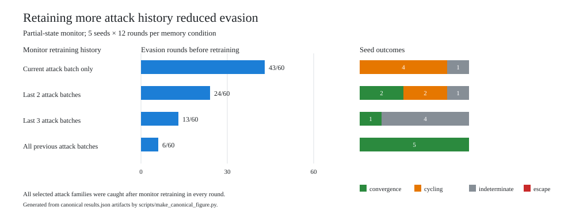

# Canonical meta-selector summary

Generated from local canonical `runs/*/results.json` artifacts with:

```powershell
& '.\.venv\Scripts\python.exe' '.\scripts\summarize_meta_selector.py' --runs-dir '.\runs'
```

The canonical artifact hashes and commands are recorded in `experiment_log.md`. The matching SVG is generated by `scripts/make_canonical_figure.py` at `figures/meta_selector_summary.svg`.



| Condition | Runs | Rounds | Pre-update evasion rounds | Post-update caught rounds | Regimes |
|---|---:|---:|---:|---:|---|
| Full-state | 5 | 60 | 0 | 60 | convergence 5 |
| Partial-state | 5 | 60 | 43 | 60 | cycling 4, indeterminate 1 |
| Memory: current batch | 5 | 60 | 43 | 60 | cycling 4, indeterminate 1 |
| Memory: last 2 batches | 5 | 60 | 24 | 60 | convergence 2, cycling 2, indeterminate 1 |
| Memory: last 3 batches | 5 | 60 | 13 | 60 | convergence 1, indeterminate 4 |
| Memory: cumulative | 5 | 60 | 6 | 60 | convergence 5 |

Notes:

- A pre-update evasion round is counted when the selected attack family executes at least one violation before monitor retraining.
- A post-update caught round is counted when the selected family executes zero violations after monitor retraining.
- The Window 3 and cumulative counts were corrected on 2026-10-22 by recomputing them from the hash-matched artifacts.
